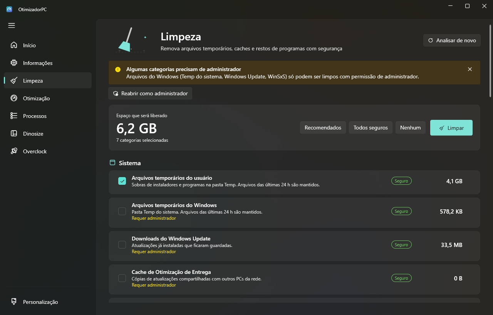
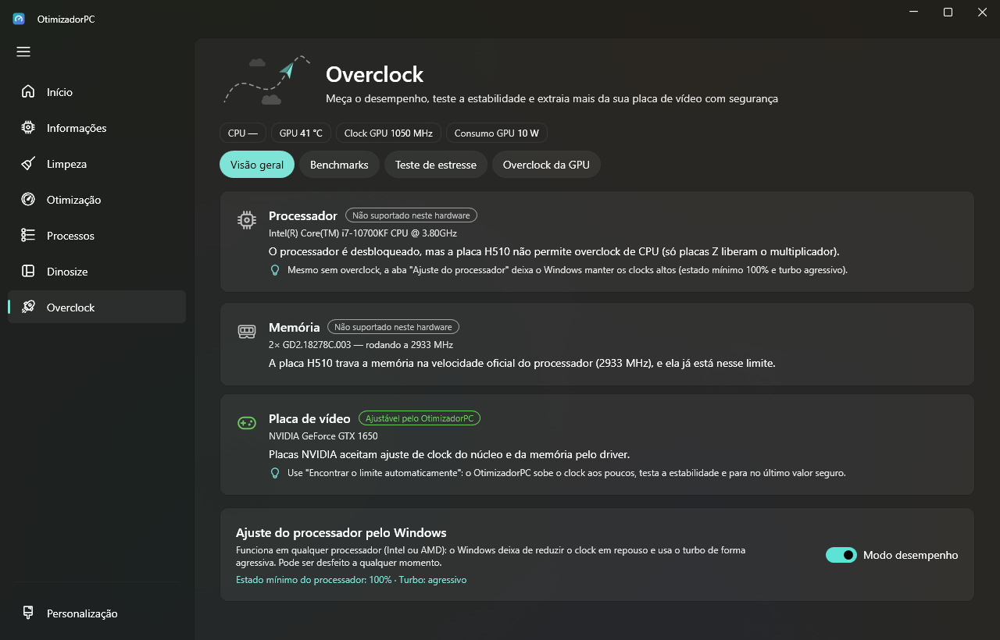

# OtimizadorPC

Aplicativo para Windows 10/11 que reúne em um só lugar limpeza, otimização, diagnóstico, análise de disco e overclock — com interface Fluent, temas personalizáveis e animações.


## Instalação

1. Baixe `OtimizadorPC-Setup-<versão>.exe` na aba [Releases](https://github.com/DaviDinoVargas/OtimizadorPC/releases).
2. Execute e siga o assistente. O instalador:
   - baixa e instala o **.NET 10 Desktop Runtime** só se ele ainda não estiver no computador;
   - cria atalhos no menu Iniciar e na Área de Trabalho;
   - pode iniciar o app junto com o Windows;
   - oferece o driver de sensores **PawnIO** (opcional) para ler temperatura e consumo do processador;
   - registra o app em **Configurações > Aplicativos instalados**, de onde ele pode ser desinstalado.

O OtimizadorPC pede permissão de administrador ao abrir, porque limpeza do sistema, serviços, sensores e overclock dependem dela.

## Módulos

| Módulo | O que faz |
|---|---|
| **Início** | CPU, memória, placa de vídeo e disco do sistema ao vivo, com gráficos animados e recomendações automáticas com atalho para resolver |
| **Informações** | Sistema, processador, placa-mãe e BIOS, memória por pente, vídeo, armazenamento, paginação e sensores ao vivo; relatório para copiar ou salvar |
| **Limpeza** | Temporários, Windows Update, relatórios de erro, logs, miniaturas, shaders, lixeira, WinSxS (DISM), Windows.old, cache de navegadores, npm/pip/NuGet/Yarn/Gradle, Discord, Steam, Epic, Spotify e jogos órfãos da Steam |
| **Otimização** | Otimização rápida com ponto de restauração, inicialização, serviços, tarefas agendadas, ajustes do Windows (jogos, desempenho, visual e privacidade), planos de energia, memória virtual e remoção de apps pré-instalados |
| **Processos** | Processos agrupados por programa com classificação (sistema, aberto, segundo plano, dispensável), encerramento seguro, prioridade e "encerrar desnecessários" |
| **Dinosize** | Análise de disco com motor **Rápido** (paralelo) ou **Ultra** (MFT do NTFS): árvore de pastas expansível com colunas ordenáveis, treemap sincronizado, navegação por teclado, maiores arquivos, tipos de arquivo, **arquivos duplicados** por conteúdo, envio para a Lixeira e migração de pastas com junção |
| **Programas** | Programas instalados e apps da Loja com tamanho, data e editor; busca e filtros; desinstalação em lote (silenciosa quando possível) com ponto de restauração; limpeza das sobras (pastas e registro) e remoção de entradas órfãs |
| **Rede e DNS** | Teste de conexão para jogos (ping, jitter e perda em servidores de jogos), teste dos DNS públicos com troca em um clique, limpar cache de DNS, renovar IP e redefinir a rede |
| **Modo Jogo** | Um clique fecha o dispensável, ativa o plano Desempenho Máximo e dá prioridade alta aos jogos; tudo volta ao normal ao desligar. Ícone na bandeja e limpeza automática agendada |
| **Overclock** | O que é possível em CPU, memória e GPU para Intel, AMD e NVIDIA; benchmarks com comparação antes/depois; teste de estresse com verificação de erros; ajuste de clock NVIDIA manual ou automático com relatório de ganho, temperatura, consumo e custo na conta de luz |
| **Personalização** | Tema claro/escuro/sistema, fundo Mica/Acrílico, 10 cores de destaque ou cor própria, barra lateral à esquerda ou à direita, expandida ou compacta, densidade, escala da interface e animações |

<table>
  <tr>
    <td></td>
    <td></td>
  </tr>
  <tr>
    <td></td>
    <td></td>
  </tr>
  <tr>
    <td colspan="2"></td>
  </tr>
</table>

### Segurança

- Nada é apagado ou alterado sem confirmação; categorias arriscadas ficam desmarcadas e sinalizadas.
- Arquivos em uso são ignorados, junções e links simbólicos nunca são seguidos, e pastas do sistema não podem ser movidas ou apagadas.
- A otimização rápida cria um ponto de restauração antes de aplicar mudanças, e todos os ajustes podem ser desfeitos pela própria tela.
- Processos essenciais do Windows não podem ser encerrados.
- O overclock automático testa cada passo com cálculos verificados, para ao primeiro erro, perda do driver ou temperatura acima de 85 °C, e volta ao último valor estável com margem de segurança. Os clocks voltam ao padrão ao reiniciar o computador.
- O arquivo de paginação nunca é sugerido nas letras A: e B:, que o Windows não aceita.
- Na busca de duplicados sempre fica pelo menos uma cópia de cada arquivo, e links físicos não contam como cópia.
- Sobras de programas vão para a Lixeira; chaves do registro são exportadas em `.reg` antes de apagar.
- O Modo Jogo guarda o estado em disco: se o programa fechar com ele ligado, o plano de energia e as prioridades voltam ao normal na próxima abertura.
- A limpeza automática usa só as categorias seguras e nunca esvazia a Lixeira.

## Arquitetura

```
src/
  OtimizadorPC.Core            Modelos, regras e contratos sem dependência de plataforma
                               (diagnóstico, classificação de processos, treemap, busca automática de overclock)
  OtimizadorPC.Infrastructure  Implementações para Windows: WMI, registro, LibreHardwareMonitor, MFT do NTFS,
                               NVAPI, Direct3D 11, TaskScheduler, PackageManager e APIs de energia
  OtimizadorPC.App             Interface WPF (MVVM com CommunityToolkit.Mvvm e WPF-UI)
  OtimizadorPC.Setup           Instalador e desinstalador em WPF
tests/
  OtimizadorPC.Tests           Testes xUnit (regras puras e leituras reais, sem alterar o sistema)
build/
  Publicar.ps1                 Gera o instalador em arquivo único
```

Bibliotecas: [WPF-UI](https://github.com/lepoco/wpfui), [CommunityToolkit.Mvvm](https://github.com/CommunityToolkit/dotnet), [LibreHardwareMonitorLib](https://github.com/LibreHardwareMonitor/LibreHardwareMonitor), [NvAPIWrapper](https://github.com/falahati/NvAPIWrapper), [Vortice.Windows](https://github.com/amerkoleci/Vortice.Windows), [TaskScheduler](https://github.com/dahall/TaskScheduler), [Serilog](https://serilog.net) e Microsoft.Extensions.Hosting.

## Desenvolvimento

Requisitos: Windows 10/11 x64 e .NET SDK 10.

```powershell
dotnet build OtimizadorPC.sln
dotnet test
```

A configuração **Debug** abre sem pedir administrador (recursos que precisam de elevação avisam na tela); a **Release** pede administrador.

Gerar o instalador:

```powershell
.\build\Publicar.ps1 -Versao 1.1.0
```

O arquivo sai em `artifacts\OtimizadorPC-Setup-1.1.0.exe`. Criar uma tag `v1.1.0` no GitHub faz o mesmo automaticamente e publica o instalador em Releases.

Configurações e logs ficam em `%APPDATA%\OtimizadorPC`.

## Licença

MIT — veja [LICENSE](LICENSE).
